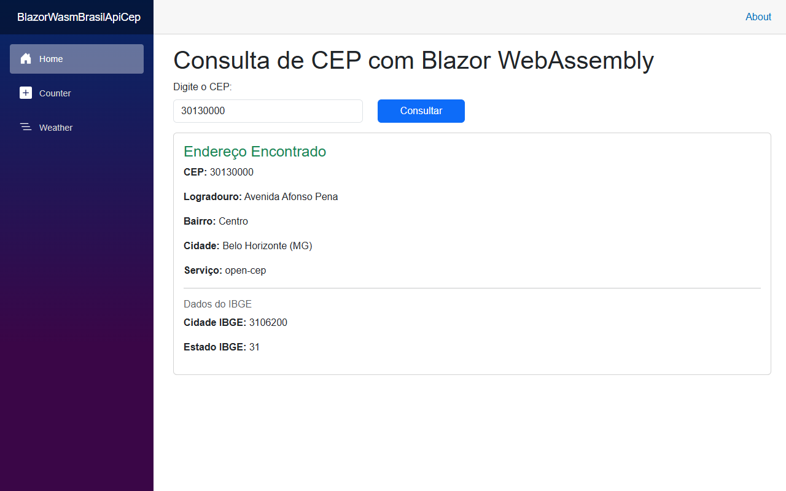

# blazor-brasilapi-cep

Exercício de consumo da BrasilAPI com C# e Blazor WebAssembly, seguindo o material `12.net_blazor_vscode.pdf`.

## Executar no VS Code

Pré-requisito: .NET SDK 10. O projeto foi criado com `dotnet new blazorwasm -n BlazorWasmBrasilApiCep`, conforme o material, usando o SDK instalado (10.0.400). As capturas do PDF também mostram o template do .NET 10.

Abra esta pasta no VS Code. No terminal:

```powershell
cd BlazorWasmBrasilApiCep
dotnet restore
dotnet build
dotnet run --launch-profile http
```

Acesse http://localhost:5092. Digite `30130000` e clique em **Consultar**. Também são aceitos CEPs com hífen, como `30130-000`, e envio por Enter.

A aplicação precisa de internet para consultar a BrasilAPI. Para encerrar, pressione **Ctrl+C** no terminal.

## Implementação conforme o roteiro

| Orientação | Implementação |
| --- | --- |
| Projeto Blazor WebAssembly chamado BlazorWasmBrasilApiCep | `BlazorWasmBrasilApiCep/BlazorWasmBrasilApiCep.csproj` |
| Modelos de resposta Cep e Ibge | `BlazorWasmBrasilApiCep/Models/Cep.cs` e `Models/Ibge.cs` |
| Registrar HttpClient em Program.cs | Base `https://brasilapi.com.br/` e limite de 30 segundos |
| Consultar CEP em Home.razor | Requisição HTTP assíncrona e desserialização JSON |
| Exibir endereço e dados do IBGE | CEP, logradouro, bairro, cidade, UF, serviço e IBGE quando presente |
| Interface apresentada nas capturas | Template original, navegação Home/Counter/Weather, formulário Bootstrap e cartão de resultado |
| Conferir erros e executar com dotnet run | Compilação e testes de navegador realizados |
| Limpar bin e obj | Removidos após os testes |
| Usar .gitignore do Visual Studio | Gerado por `dotnet new gitignore` |
| Repositório GitHub blazor-brasilapi-cep | https://github.com/jujuhpe/blazor-brasilapi-cep |

O texto de alguns slides omite `/api` na URL. Foi usada a rota funcional `https://brasilapi.com.br/api/cep/v1/{cep}`, exibida nas capturas da documentação do próprio material e confirmada com uma chamada real.

As propriedades dos modelos preservam os nomes JSON mostrados no PDF. As strings são inicializadas para evitar avisos de nulabilidade. `ibge` é opcional para que a tela também aceite respostas sem esse campo. A página Weather mantém sua consulta ao JSON local, mesmo com o HttpClient apontando para a BrasilAPI.

## Validação realizada

- `dotnet build`: zero erros de compilação. Um aviso NU1900 porque o serviço de auditoria de vulnerabilidades do NuGet não pôde ser acessado; a auditoria permanece habilitada.
- `dotnet run --launch-profile http`: servidor iniciou em `http://localhost:5092`.
- Navegador Edge: consulta real de `30130000` retornou Avenida Afonso Pena, Centro, Belo Horizonte (MG), cidade IBGE `3106200` e estado IBGE `31`.
- Testes da interface: CEP com hífen, Enter, campo vazio, tamanho inválido, letras e caracteres inválidos.
- Respostas simuladas: HTTP 400, 404 e 500, JSON inválido, JSON nulo, falta de IBGE e campos de endereço vazios.
- Carregamento bloqueia novas consultas; falha de rede apresenta mensagem compreensível.
- Counter e Weather continuam funcionando.
- Layout conferido em desktop e celular, sem rolagem horizontal; nenhum erro JavaScript não tratado.



## GitHub

Repositório: https://github.com/jujuhpe/blazor-brasilapi-cep

O repositório é público, com o `.gitignore` do Visual Studio e os arquivos do exercício na branch `main`.

Antes de cada envio, encerre a aplicação e remova apenas `BlazorWasmBrasilApiCep/bin` e `BlazorWasmBrasilApiCep/obj`, como orientado no PDF. Esses diretórios também estão cobertos pelo `.gitignore`.

Documentação da API: https://brasilapi.com.br/docs#tag/CEP
